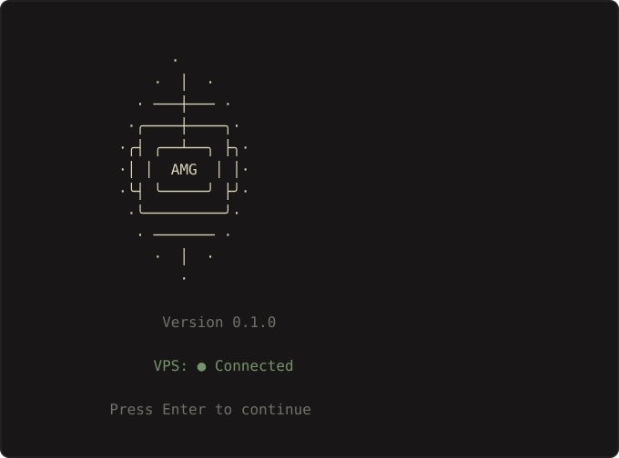
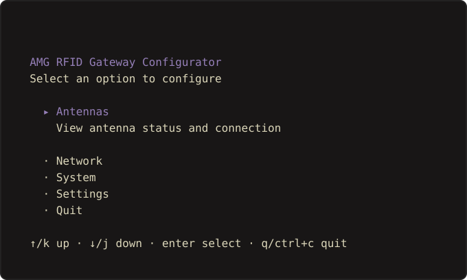
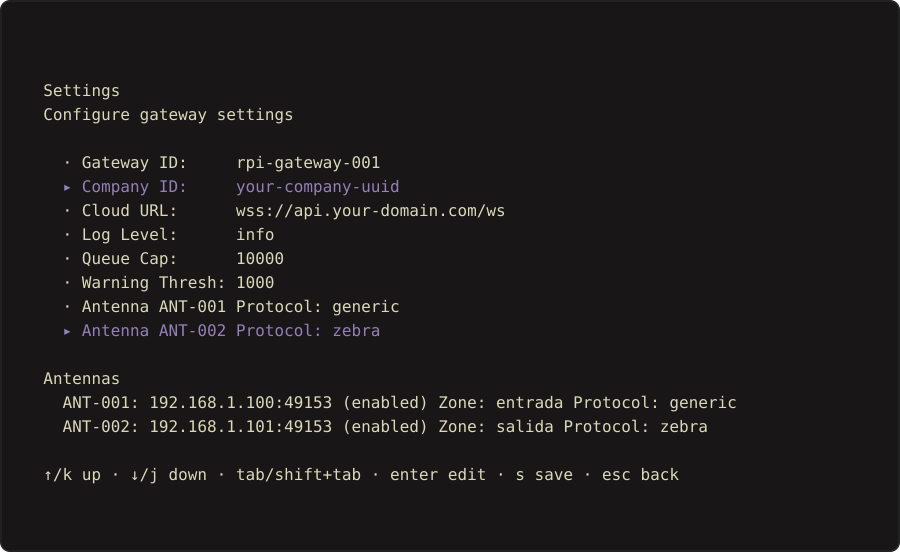

# AMG-RFID Gateway

Edge Gateway for Raspberry Pi that connects RFID antennas to the cloud backend.

## Overview

This gateway acts as a bridge between RFID antennas (using raw TCP protocol) and the AMG-RFID cloud backend. It provides:

- **Splash Screen**: ASCII art logo with version display and VPS connection status on startup
- **Auto-Detect Configuration**: Binary automatically finds config.yaml in standard locations
- **TUI Configurator**: Terminal-based configuration with full settings editing
- **Local Caching**: SQLite-based buffering for offline operation
- **Automatic Sync**: Batches readings to the cloud over HTTPS (`POST /api/v1/gateway/sync`) with the device token
- **Reading Sessions**: Repeated reads of one tag on one antenna are merged into a single session (first read, last read, read count, strongest RSSI: the largest known signed dBm, unknown reads never win) that is uploaded once the tag goes unread for `reading_session_idle` (default 5s) or after `reading_session_max` (default 60s); the local panel and movement detection still see every read
- **Multi-Antenna Support**: Connect multiple antennas simultaneously
- **Per-Antenna Protocol Config**: Configure each antenna protocol independently (`generic` by default)
- **Web UI**: Built-in web interface for manual tag confirmation
- **Updates**: Manual upgrades via Homebrew (no automatic updates)
- **Health Monitoring**: Built-in health checks and Prometheus metrics

## Architecture

```
┌─────────────────────────────────────────────────────────────┐
│                    Raspberry Pi (Gateway)                    │
│  ┌──────────────┐  ┌──────────────┐  ┌──────────────────┐   │
│  │  Antenna 1   │  │  Antenna 2   │  │   TUI Config     │   │
│  │  (Raw TCP)   │  │  (Raw TCP)   │  │   (Bubbletea)    │   │
│  └──────┬───────┘  └──────┬───────┘  └────────┬─────────┘   │
│         │                 │                    │             │
│         └─────────────────┼────────────────────┘             │
│                           ▼                                  │
│                  ┌────────────────┐                          │
│                  │  SQLite Cache  │                          │
│                  │  (local store) │                          │
│                  └───────┬────────┘                          │
│                          │                                   │
│                          ▼                                   │
│                  ┌────────────────┐                          │
│                  │  Sync Engine   │                          │
│                  │  (batch+retry) │                          │
│                  └───────┬────────┘                          │
│                          │                                   │
│                          ▼                                   │
│                  ┌────────────────┐                          │
│                  │    Web UI      │                          │
│                  │  (port 9090)   │                          │
│                  └────────────────┘                          │
│                                                              │
└──────────────────────────┬───────────────────────────────────┘
                           │ HTTPS (device token)
                           ▼
┌─────────────────────────────────────────────────────────────┐
│                    Cloud Backend                             │
│            api.amg-rfid.com/api/v1/gateway/sync             │
└─────────────────────────────────────────────────────────────┘
```

## Features

### Core Features

| Feature | Description |
| --------- | ------------- |
| **Splash Screen** | ASCII art logo with RFID waves, version, and VPS connection status |
| **Auto-Detect Config** | Binary searches config automatically in standard locations |
| **SQLite Cache** | Thread-safe local storage with WAL mode for durability |
| **Buffered Writes** | 1000-capacity channel with background flush every 1s |
| **Batch Sync** | Sends up to 100 readings per request to minimize API calls |
| **Auto-Retry** | Exponential backoff (max 5 retries) for failed syncs |
| **Reconnect Logic** | Automatic antenna reconnection with configurable backoff |
| **Multi-Antenna** | Supports multiple antennas via goroutines |
| **Protocol Config** | Per-antenna protocol selection with backward-compatible `generic` default |
| **Web UI** | Built-in verification interface on port 9090 |
| **Kanban Tags** | Cached kanban catalog, unassigned-tag inbox and online-only assignment (see [Kanban Tags and Unassigned Tags](#kanban-tags-and-unassigned-tags)) |
| **Settings TUI** | Full configuration editing with explicit save confirmation and unsaved-exit protection |

### TUI Configurator

Interactive terminal interface using Bubbletea with splash screen and multiple screens:

```bash
# Run TUI configurator (auto-detects config)
./gateway-tui

# Or run directly with auto-detected config
./gateway-tui
```

**Flow:**

1. **Splash Screen** (2 seconds): ASCII logo + version + VPS connection status
2. **Main Menu**: Navigate to Antennas, Network, System, Settings, or Quit

#### Splash Screen



#### Main Menu



#### Settings



**Screens:**

- **Antennas**: View all connected antennas, their status, reading counts, and last tag EPC/RSSI
- **Network**: Connection state to cloud backend and VPS API
- **System**: Gateway ID, company ID, version, backend/gateway uptime, cache size, sync status
- **Settings**: Full TUI-based configuration editor with field validation
  - Gateway ID, Company ID, Cloud URL, Log Level
  - Queue Cap, Warning Threshold
  - View antenna configurations and edit each antenna protocol with a constrained `generic`/`zebra`/`chainway` selector (plus per-port locations for `chainway`)
  - Save changes explicitly with `s`, then confirm with `y`
  - Leaving Settings with unsaved changes prompts to save, discard, or stay

**Navigation:**

- Arrow keys or `j/k` to navigate; navigable lists wrap at the first/last item
- Enter to select/edit
- In Settings protocol fields, `←/→`, Space, or Enter cycles supported values (`generic`, `zebra`, `chainway`)
- In Settings, `s` opens save confirmation; `y` persists changes
- `q` or `Ctrl+C` to quit
- `Esc` to go back

### Updates

The gateway does not update itself. `internal/updater` contains OTA code that
is not wired into the gateway yet, so upgrades are manual through Homebrew:

```bash
brew update && brew upgrade amg-rfid-gateway
```

Each release updates the tap formula automatically. Homebrew verifies the
release tarball SHA256 and keeps `config.yaml` and data outside the keg.

## Installation

### Homebrew (Recommended)

```bash
# Add the tap
brew tap AMG-Repo/tap

# Install
brew install amg-rfid-gateway

# Run with auto-detected config
gateway

# Or run TUI
gateway-tui

# As a service
brew services start amg-rfid-gateway
```

### Release Tarball (Alternative, systemd under /opt)

Releases publish `amg-rfid-gateway-vX.Y.Z-linux-{arm64,amd64}.tar.gz` (with
`gateway`, `gateway-tui` and `config.example.yaml`) plus `checksums.txt`.

```bash
VERSION=v0.7.2   # see https://github.com/AMG-Repo/amg-rfid-gateway/releases
ARCH=arm64       # or amd64
BASE=https://github.com/AMG-Repo/amg-rfid-gateway/releases/download/$VERSION
PKG=amg-rfid-gateway-$VERSION-linux-$ARCH

# 1. Download and verify
curl -fsSLO "$BASE/$PKG.tar.gz"
curl -fsSLO "$BASE/checksums.txt"
sha256sum -c --ignore-missing checksums.txt
tar -xzf "$PKG.tar.gz"

# 2. Install with the script, using the verified local binary
curl -fsSLO https://raw.githubusercontent.com/AMG-Repo/amg-rfid-gateway/main/scripts/install.sh
sudo bash install.sh --binary "$PKG/gateway"
sudo install -m 0755 "$PKG/gateway-tui" /opt/amg-rfid-gateway/gateway-tui
```

Always pass `--binary`: the script's own download step still uses legacy
asset names.

### Manual Installation

```bash
# 1. Create user and directories
sudo useradd -r -s /bin/false gateway
sudo mkdir -p /opt/amg-rfid-gateway/data
sudo chown -R gateway:gateway /opt/amg-rfid-gateway

# 2. Download, verify and extract the release (variables as above)
curl -fsSLO "$BASE/$PKG.tar.gz"
curl -fsSLO "$BASE/checksums.txt"
sha256sum -c --ignore-missing checksums.txt
tar -xzf "$PKG.tar.gz"
sudo install -m 0755 "$PKG/gateway" "$PKG/gateway-tui" /opt/amg-rfid-gateway/

# 3. Create config
sudo cp "$PKG/config.example.yaml" /opt/amg-rfid-gateway/config.yaml
# Edit config.yaml with your settings

# 4. Install systemd service
sudo cp scripts/systemd/gateway.service /etc/systemd/system/
sudo systemctl daemon-reload
sudo systemctl enable gateway
sudo systemctl start gateway
```

### Build from Source

```bash
# Requirements: Go 1.25+

# Clone repository
git clone https://github.com/AMG-Repo/amg-rfid-gateway.git
cd amg-rfid-gateway

# Build for Raspberry Pi (ARM64)
make build-arm64

# Or build for ARMv7 (older Pi)
make build-arm

# Build TUI
make build-tui

# Build all binaries
make build-all
```

## Configuration

The gateway auto-detects configuration files in this order:

1. `$GATEWAY_CONFIG` environment variable
2. `./config.yaml` (current directory)
3. `$(brew --prefix)/etc/amg-rfid-gateway/config.yaml` (Homebrew)
4. `/etc/amg-rfid-gateway/config.yaml` (system)

This means `--config` flag is now optional:

```bash
# These all work the same if config is in a standard location
./gateway
./gateway --config /etc/amg-rfid-gateway/config.yaml
GATEWAY_CONFIG=/path/to/config.yaml ./gateway
```

When no config file is found, the gateway reads its settings from environment
variables (`GATEWAY_ID`, `COMPANY_ID`, `CLOUD_URL`, ...). The device credential
path is set with `GATEWAY_CREDENTIAL_FILE` (equivalent to `gateway_credential_file`)
and the backend API with `VPS_API_URL` (equivalent to `vps_api_url`).

### Complete Configuration Example

```yaml
# AMG RFID Gateway Configuration

# Gateway identification
gateway_id: "rpi-gateway-001"
company_id: "your-company-uuid"

# Cloud backend connection
cloud_url: "wss://api.your-domain.com/ws"  # Validated but unused: readings sync over HTTPS (vps_api_url)
gateway_credential_file: "/etc/amg-rfid-gateway/gateway.secret"
vps_api_url: "https://api.your-domain.com"  # Backend REST API base URL (token endpoint, tool sync)

# Synchronization settings
sync_interval: 30s
batch_size: 100
reading_session_idle: 5s   # queue a tag session after 5s without reading it
reading_session_max: 60s   # queue it after 60s even if the tag is still read
auto_confirm_idle: 1m      # automatic mode: a tag pass ends after 1m without reads
auto_confirm_min_reads: 3  # automatic mode: confirm only passes with at least 3 reads
max_retries: 5

# Health check endpoint port
health_port: 8080

# Data storage path (SQLite database)
data_path: "/opt/amg-rfid-gateway/data"

# Antenna configurations
# Protocol field: "generic" is the supported default for current packet handling.
# "zebra" is accepted by configuration and fails explicitly at runtime until
# Zebra-specific reader support is implemented.
# Zone field: "entrada" (entry), "salida" (exit), or "" (empty for auto-detect)
antennas:
  - id: "ANT-001"
    ip: "192.168.1.100"
    port: 49153
    enabled: true
    zone: "entrada"
    protocol: "generic"

  - id: "ANT-002"
    ip: "192.168.1.101"
    port: 49153
    enabled: true
    zone: "salida"
    protocol: "generic"

  # Zebra can be selected in config/TUI, but runtime parsing is intentionally
  # unsupported until a Zebra-specific reader handler is implemented.
  # - id: "ANT-003"
  #   ip: "192.168.1.102"
  #   port: 5084
  #   enabled: false
  #   zone: ""
  #   protocol: "zebra"

# Permanent Listening Mode (REQ-A006)
# Controls how the gateway handles continuous antenna connections
listen_mode: "auto"                    # Options: "active", "passive", "auto"
heartbeat_interval: 3s                 # How often to send heartbeat pings
heartbeat_silence_threshold: 5s        # Silence threshold for connection health

# Adaptive Delay Configuration
# Fine-tune reading detection sensitivity based on tag activity
adaptive_delay_recent: 3s              # Delay after recent tag detection
adaptive_delay_recent_window: 2s       # Window for "recent" classification
adaptive_delay_stale: 1s               # Delay when no tags detected recently
adaptive_delay_stale_window: 10s       # Window for "stale" classification
adaptive_delay_auto_reading: 5s        # Auto-reading delay in auto mode

# Reconnection Configuration
reconnect_initial_backoff: 1s          # Initial retry backoff (doubles each attempt)
reconnect_max_backoff: 30s             # Maximum backoff between reconnection attempts
socket_path: "/tmp/amg-rfid-gateway.sock"  # Unix socket for TUI bridge

# Web UI Configuration (Local Verification Frontend)
web_enabled: true                      # Enable/disable the web UI
web_port: 9090                         # Port for the web server
web_listen_addr: "0.0.0.0"             # Bind address (0.0.0.0 = all interfaces)
sync_tools_interval: 1h                # How often to sync tools from VPS
confirmation_retry_interval: 30s       # Base retry interval for pending confirmations (doubles per failed attempt, max 30m)

# Queue Size Limits (Pending Confirmations)
max_pending_confirmations: 10000       # Max pending confirmations (0 = unlimited)
pending_warning_threshold: 1000        # Warning threshold (0 = never warn)

# Logging
log_level: "info"                      # debug, info, warn, error
```

Prometheus metrics have no settings: they are always served at `/metrics` on the
health listener (`health_listen_addr`:`health_port`). Root keys the gateway does
not know (for example the old `metrics:` or `updates:` sections) are ignored and
logged at startup as `WARNING: config ignores unknown root keys: ...`.

### Configuration Fields Reference

| Field | Type | Default | Description |
| ------- | ------ | --------- | ------------- |
| `gateway_id` | string | required | Unique gateway identifier |
| `company_id` | string | required | Company UUID for authentication |
| `cloud_url` | string | required | WebSocket URL (wss://). Still validated, but no longer used: readings sync over HTTPS to `vps_api_url` |
| `gateway_credential_file` | string | required | Path to a mode 0600 file containing the device secret issued by the backend |
| `sync_interval` | duration | 30s | How often to sync to cloud |
| `batch_size` | int | 100 | Readings per sync request |
| `reading_session_idle` | duration | 5s | A tag session is closed and queued after this long without reading the tag |
| `reading_session_max` | duration | 60s | A tag session still being read is closed and queued after this long (must be >= `reading_session_idle`) |
| `auto_confirm_idle` | duration | 1m | Automatic confirmation: a tag pass ends after this long without reads (at least `30s` when set; `0` or unset = default) |
| `auto_confirm_min_reads` | int | 3 | Automatic confirmation: minimum reads in a pass to confirm it (must be positive; `0` or unset = default) |
| `max_retries` | int | 5 | Max retry attempts for failed syncs |
| `health_port` | int | 8080 | HTTP port for health/metrics |
| `data_path` | string | ./data | SQLite database location |
| `listen_mode` | string | auto | Antenna listening mode (active/passive/auto) |
| `heartbeat_interval` | duration | 3s | Heartbeat ping interval |
| `heartbeat_silence_threshold` | duration | 5s | Connection health threshold |
| `adaptive_delay_*` | duration | varies | Fine-tune reading sensitivity |
| `reconnect_*` | duration | varies | Reconnection backoff settings |
| `web_enabled` | bool | true | Enable web UI |
| `web_port` | int | 9090 | Web UI port |
| `web_listen_addr` | string | 0.0.0.0 | Web UI bind address |
| `vps_api_url` | string | required | VPS REST API base URL (device token endpoint and tool sync). Must be `https://`; `http://` is only accepted for loopback hosts |
| `sync_tools_interval` | duration | 1h | Tool sync frequency |
| `confirmation_retry_interval` | duration | 30s | Base wait before resending a failed confirmation; it doubles after each failure (`interval × 2^(failures-1)`, capped at 30 min). After 10 failed sends the confirmation is stuck until requeued |
| `max_pending_confirmations` | int | 10000 | Queue size limit (0=unlimited); at the limit new confirmations are rejected with `queue_full`, nothing queued is discarded |
| `pending_warning_threshold` | int | 1000 | Warning threshold (0=never) |
| `log_level` | string | info | Logging verbosity: `debug` also logs every raw read and reader frame; `info` logs one line per closed reading session; `warn`/`error` keep only warnings and errors |

### Antenna Protocols

Each antenna supports a `protocol` field:

| Protocol | Status | Use when |
| ---------- | -------- | ---------- |
| `generic` | Supported default | The antenna speaks the current generic RFID TCP packet format |
| `zebra` | Configurable, explicit runtime unsupported | Preparing configuration for a future Zebra-specific handler |
| `chainway` | Supported | The antenna is a Chainway UR4 fixed reader (see [Chainway UR4](#chainway-ur4-protocol-chainway)) |

Existing configs without `protocol` are treated as `generic`. Unsupported protocol values fail configuration validation so the gateway does not accidentally parse another reader type as generic.

You can edit antenna protocol values from the Settings TUI using the constrained selector (`generic`/`zebra`/`chainway`). At runtime, non-generic protocols are routed through the protocol handler boundary; until a Zebra handler exists, `zebra` fails explicitly instead of being parsed as generic.

### Chainway UR4 (protocol: chainway)

The `chainway` protocol reads tags from a Chainway UR4 fixed UHF reader over Ethernet in command work mode. The gateway dials the reader, sends start-inventory, and consumes its tag notifications; no vendor library is needed.

- Default address: `192.168.99.202:8888` (confirmed on hardware).
- `port_locations` (optional) maps a reader port (1-4) to a location name. That name is recorded as the reading's antenna ID, so tags can be traced by location, for example port 1 = `entrada-x` and port 2 = `salida-x`. A port without a mapping falls back to the configured antenna `id`. `port_locations` is only valid with `protocol: chainway`; ports must be 1-4 and locations cannot be blank.
- In the Settings TUI, choose `chainway` in the antenna editor to edit the location of ports 1-4 (leave one empty to keep it unmapped). Switching to another protocol clears the locations.

```yaml
antennas:
  - id: "UR4-001"
    ip: "192.168.99.202"
    port: 8888
    enabled: true
    protocol: "chainway"
    port_locations:
      1: "entrada-x"
      2: "salida-x"
```

> **Warning:** never run a `chainway` antenna against a UR4 without an antenna or a 50-ohm terminator attached to its RF port. The gateway sends start-inventory (RF on) as soon as it connects, and transmitting into an open port can damage the reader.

## Usage

### Start Gateway

```bash
# With auto-detected config (recommended)
./gateway

# Or specify config explicitly
./gateway --config /opt/amg-rfid-gateway/config.yaml

# With verbose logging
./gateway --log-level debug

# As systemd service
sudo systemctl start gateway
sudo systemctl status gateway
```

### View Logs

```bash
# Via systemd
sudo journalctl -u gateway -f

# Or check log files
sudo tail -f /opt/amg-rfid-gateway/data/gateway.log
```

### TUI Configuration

```bash
# Launch TUI with splash screen and auto-detected config
./gateway-tui

# The TUI shows:
# 1. Splash screen (2s): Logo, version, VPS status
# 2. Main Menu: Navigate with arrow keys
#    - Antennas: View antenna status and readings
#    - Network: Cloud connection status
#    - System: Gateway metrics and backend-reported uptime
#    - Settings: Edit configuration fields; changes stay in memory until explicitly saved
#    - Quit: Exit the TUI

# Navigate with arrow keys or j/k; list navigation wraps
# Enter to select/edit
# In Settings, edits are not persisted until 's' save + 'y' confirm
# If you leave Settings with unsaved edits, choose y save, d discard, or n stay
# Antenna protocol fields cycle between generic and zebra; free-text protocol entry is not used
# q or Ctrl+C to quit
# Esc to go back
```

### Health Check

```bash
# Check gateway health
curl http://localhost:8080/health

# Response:
# {
#   "status": "healthy",
#   "gateway_id": "gateway-001",
#   "antennas_connected": 2,
#   "cache_pending": 0,
#   "last_sync": "2024-01-15T10:30:00Z"
# }
```

`cache_size` in `/health` (and the `gateway_readings_pending` metric) counts only readings not yet synced to
the VPS; the status is `syncing` while that backlog is non-empty. Readings already synced are kept
locally for 7 days and then purged by the sync engine (checked hourly), so delivered readings no longer
accumulate in the SQLite cache.
Readings the VPS rejects terminally are kept locally as rejected (`synced = 2`): they are not counted
as pending, are never resent, and the retention purge never deletes them.

### Prometheus Metrics

```bash
# Scrape metrics
curl http://localhost:8080/metrics

# Key metrics:
# gateway_readings_pending - Number of unsynced readings
# gateway_sync_success_total - Total successful syncs
# gateway_sync_failure_total - Total failed syncs
# gateway_uptime_seconds - Gateway uptime
# gateway_antennas_connected - Number of connected antennas
```

### Web UI

When `web_enabled: true`, access the web interface at:

```
http://gateway-ip:9090
```

Features:

- Manual tag confirmation interface
- Real-time reading display
- Tool verification status

The header has a **Manual / Automático** switch (needs the web token in LAN mode) that calls
`POST /api/auto-confirm` and survives restarts. In automatic mode a banner shows the rule
("Automático: confirma solo tras 1 min sin lectura y 3+ lecturas", from `auto_confirm_idle` and
`auto_confirm_min_reads`), auto-confirmed tags drop their pending card, and today's history marks
those movements with a small "auto" tag. Manual mode looks and works as before.

## Testing

```bash
# Run all tests
make test

# Run with coverage
make test-coverage

# Run specific package tests
go test ./internal/cache/... -v
go test ./internal/sync/... -v
go test ./test/e2e/... -v

# E2E tests (require mock backend)
go test ./test/e2e/... -v --tags=e2e
```

## API Integration

The gateway communicates with the cloud backend using these endpoints:

| Endpoint | Method | Description |
| ---------- | -------- | ------------- |
| `/api/v1/gateway/sync` | POST | Send batch of raw readings (Bearer device token; body = SyncRequest, max 500 readings; per-reading rejections in `errors[]` as `reading[<index>]: <reason>`) |
| `/api/v1/gateway/confirm` | POST | Send a confirmation `{company_id, uii, action, antenna_id, confirmation_id, occurred_at}` (Bearer device token; see Cloud contract) |
| `/api/v1/rfid/pending` | GET | Get pending confirmations |
| `/api/v1/health/gateways` | GET | Health check |
| `/metrics` | GET | Prometheus metrics |
| `/health` | GET | Simple health status |

**Authentication:** The gateway exchanges its device credential (`gateway_id` + the secret in `gateway_credential_file`) at `POST /api/v1/gateway/auth/token` for a 12 h Bearer token. The token is renewed automatically at ~80% of its lifetime or after a 401; no manual token handoff is needed.

## Kanban Tags and Unassigned Tags

Operators recognize **kanban cards**, not EPCs. The kanban catalog and the tag-to-kanban
assignments are maintained on the VPS; the gateway keeps a read-only copy and never edits
kanban data.

- **Assigned tag**: its UII (EPC) is linked to a kanban. Reads carry the kanban fields
  (`code`, `description`, `standard_pack`, `unit`, `zones`, `extrusora`, `position`, `area`,
  `customer`, `card_type`, `sku`).
- **Unassigned tag**: a read whose UII has no active kanban link. It is listed in the local
  unassigned inbox (EPC, antenna, first/last seen, read count) until it is assigned, or until it
  has not been read for 24 hours (it reappears on its next read). Unassigned reads never create
  movements. Employee badges (a synced user `rfid_tag`) are not listed.
- **Assigning requires the VPS online.** There is no offline assignment queue: if the VPS is
  unreachable the request fails with `503` and nothing is stored locally.
- **Movements only for assigned tags.** `POST /api/confirm` rejects a UII without a kanban link.

### Local web API

All routes are served by the web UI (`web_port`). Reads have no auth; writes (`POST`) require
the bearer token when `web_access_mode: lan`.

| Endpoint | Method | Auth | Description |
| ---------- | -------- | ------ | ------------- |
| `/api/unassigned-tags` | GET | none | `[{epc, antenna_id, first_seen, last_seen, read_count}]`, most recent first |
| `/api/kanbans` | GET | none | Cached kanban catalog (picker source), ordered by `code` |
| `/api/antennas` | GET | none | `[{id, zone, state, last_read_at}]` per configured antenna; `state` is `reading`, `reconnecting` or `stopped` (disabled); `zone` is `entrada`, `salida` or `""`; `last_read_at` is `null` until the first tag read |
| `/api/status` | GET | none | `{vps_online, pending_count, tools_count, pending_warning, oldest_pending_at, pending_warning_threshold, last_sync_at, max_pending_confirmations, stuck_count, auto_confirm, auto_confirm_idle_seconds, auto_confirm_min_reads}`; `auto_confirm` is `true` in automatic confirmation mode, `auto_confirm_idle_seconds`/`auto_confirm_min_reads` are the configured pass thresholds; `max_pending_confirmations` is the enforced queue cap (`0` = unlimited), `stuck_count` counts pending confirmations that reached the sync worker's max retries (kept queued, no longer sent); `oldest_pending_at` is when the oldest pending confirmation was queued (`null` when none), `pending_warning_threshold` is the configured threshold (default 1000, `0` = never warn), `last_sync_at` is the last time a confirmation reached the VPS (online confirm or worker flush; `null` when none is recorded) |
| `/api/history` | GET | none | Today's confirmations (gateway local day), newest first: `[{uii, kanban_code, description, quantity, unit, action, antenna_id, time, synced, auto}]`. `auto` is `true` for movements the gateway confirmed by itself (automatic mode). `quantity` is the kanban `standard_pack`; the four kanban fields are `null` when the tag has no active kanban link; `synced` is `false` while the confirmation is still queued for the VPS |
| `/api/tags/assign` | POST | write auth | Assign a tag to a kanban (online only) |
| `/api/confirm` | POST | write auth | Confirm entrada/salida (assigned tags only); `409` while an automatic confirm of the same tag is in progress, and `409 {"error": "Este movimiento ya se confirmó automáticamente."}` after one until the tag is read again |
| `/api/confirmations/requeue` | POST | write auth | Resets the retry count and backoff of every pending confirmation stuck after a VPS rejection so the sync worker sends them again; answers `200 {"requeued": N}` (`0` when none are stuck), `405` for other methods |
| `/api/auto-confirm` | POST | write auth | Switches the confirmation mode: body `{"enabled": true}` (automatic) or `{"enabled": false}` (manual); the mode is saved in the gateway database (survives restarts) and applied at once; answers `200 {"auto_confirm": bool}`, `400` for an invalid body, `405` for other methods |
| `/events` | GET (SSE) | none | `tag_detected` and `auto_confirmed` events, see below |

**`POST /api/tags/assign`** body `{"uii": "...", "kanban_code": "...", "antenna_id": "..."}`
(`antenna_id` optional, used for audit; defaults to the antenna that read the tag, else `manual`).
The request is forwarded to the VPS (`POST /api/v1/gateway/tags/assign`); the kanban code is not
checked against the local catalog because the VPS is authoritative (the cached catalog can be stale).

| Status | `code` | Meaning |
| -------- | -------- | --------- |
| 200 | | `{success, message, uii, kanban}`. The local cache is updated, the tag leaves the inbox and an immediate sync is requested (no 1 h wait) |
| 400 | `invalid_request` | Invalid body, blank `uii`/`kanban_code`, or rejected by the VPS |
| 404 | `kanban_not_found` | The kanban does not exist on the VPS |
| 409 | `uii_assigned` | The tag belongs to another kanban; the body includes `current_kanban` |
| 502 | `vps_error` | The VPS answered with an unexpected error |
| 503 | `vps_offline` | VPS unreachable or timed out: "Sin conexión con el VPS: la asignación requiere estar en línea." |

Error bodies are `{"error": "<mensaje>", "code": "<code>"}`. Assigning the same tag to the same
kanban again is idempotent.

**Retries.** A send that fails for a transient reason (network error, timeout, 5xx, 401, 408 or
429) is retried with a per-confirmation backoff: the wait after the n-th failure is
`confirmation_retry_interval × 2^(n-1)`, capped at 30 minutes, and it is retried for as long as
the outage lasts; transient failures never make a confirmation stuck. Confirmations waiting out
their backoff are skipped by the sync worker and never crowd out due ones. Any other 4xx from the
VPS (for example 400, 404 or 409) is a rejection that resending cannot fix: the confirmation is
*stuck* at once (`stuck_count` in `/api/status`), stays queued and is not sent again until
`POST /api/confirmations/requeue` (the panel's "Reintentar" button on the "N confirmaciones sin
enviar" item) resets it. The tick is also `confirmation_retry_interval`, so a due confirmation
may wait for the next tick. Every retry and requeue resends the same `confirmation_id` and
`occurred_at`, so a send the VPS applied but whose answer was lost comes back as a `200` replay
and is marked synced, never recorded twice.

**`POST /api/confirm`** keeps its request and response shape; `message` is in Spanish
(`Confirmación enviada al VPS` online, `Confirmación guardada localmente (modo sin conexión)`
offline) while `mode` stays `online`/`offline`. Validation errors are Spanish too (400
`{"error": "Solicitud inválida."}`, `"Movimiento inválido: debe ser entrada o salida."`,
`"Falta el código de la tag (uii)."`), and a local storage failure answers
`No se pudo guardar la confirmación en el gateway.` without leaking the database error. Every confirmation is also recorded locally: an
online success is stored as synced with the send time (`synced_at`), an offline one stays pending
until the sync worker sends it. Synced confirmations older than 30 days are deleted (by
`synced_at`), except the most recent one, which keeps `last_sync_at`; pending ones are never purged. A UII with no active kanban link answers
`422 {"success": false, "message": "No se puede registrar un movimiento hasta asignar la tag a un kanban.", "code": "tag_not_assigned"}`
and nothing is sent or queued. If the assignment cannot be verified (local store error) it answers `500`.
An accepted confirmation (online or queued) updates the cached tag location right away (`entrada` →
`Almacén General`, `salida` → the kanban's first zone or empty), so the next read of the same tag suggests the
opposite movement even offline; a sync does not roll it back while the confirmation is still pending.
When the offline queue is at `max_pending_confirmations` it answers
`507 {"success": false, "message": "La cola del gateway está llena: no se guardó el movimiento. Revisá la conexión con el VPS.", "mode": "offline", "code": "queue_full"}`
and nothing queued is discarded.

**Automatic confirmation (experimental).** The default mode is manual (no stored setting means
manual): nothing changes and every movement is confirmed with the panel button. Use automatic mode
only when a single gateway reads a given set of tags: with several gateways sharing tags, a movement
recorded by another gateway is only seen here after the next tools sync (hourly by default), so an
automatic confirm in that window can repeat its direction. In automatic mode (`POST /api/auto-confirm`) the gateway tracks
each tag's pass (reads, last read, last antenna); a pass ends once the tag goes unread for
`auto_confirm_idle` (default 1 min) plus a 2 s margin for reads delayed on their way in; a read
timestamped before the start of the tag's current pass does not count toward it (nor reopens an
older pass). An ended pass is confirmed by the gateway when it had at least
`auto_confirm_min_reads` reads (default 3), the tag is linked to a kanban and it is not a user
badge; otherwise it stays for a manual confirm. The pass is claimed first and every check below uses
the values read after the claim. A tag with any confirmation still pending sync in the local queue
is never auto-confirmed (its cached location is only trusted when nothing is pending). Cooldown: a
tag with any local confirmation (manual or automatic, synced or not) whose movement time is within
the last 10 minutes is not auto-confirmed either; the pass is dropped and nothing is written (a sync
may still carry a location older than that movement). Direction: two sources must agree. The tag's
most recent retained local confirmation (manual or automatic, synced or not, by movement time) implies
the opposite movement (last `entrada` → `salida`, last `salida` → `entrada`); its known, non-blank
cached location implies one too (in the warehouse → `salida`, anywhere else → `entrada`). When both
exist and disagree (for example a movement made elsewhere, seen through the tools sync) the pass is
dropped and nothing is written; when only one exists it decides. A tag with no retained local
confirmation whose location is unknown or blank (no tool row, empty/NULL location) is not
auto-confirmed, and any failed lookup skips the pass; it stays for a manual confirm. `occurred_at` is the last read and `antenna_id` the last antenna. It uses the same path as
`POST /api/confirm` (confirmation id, online send, offline queue with retries, location update); the
movement shows `auto: true` in `/api/history` and an SSE `auto_confirmed` event
(`{"uii", "action", "confirmation_id"}`) is sent. At most one automatic confirm per pass: every
confirm (manual from the panel or automatic) claims the tag's current pass before anything is sent or
queued, so an automatic confirm never follows a manual or automatic one in the same pass; reads right before the automatic confirm keep the pass open, a failed automatic
confirm is not retried in the same pass, and a new pass starts only after the tag goes unread for a
full `auto_confirm_idle`. While an automatic confirm of a tag is in progress, a manual
`POST /api/confirm` of the same tag answers
`409 {"error": "Este movimiento ya se está confirmando automáticamente."}` and writes nothing; after
an automatic confirm, a manual `POST /api/confirm` of that tag before it is read again answers
`409 {"error": "Este movimiento ya se confirmó automáticamente."}` and writes nothing (a new read
makes manual confirms normal again). While a manual confirm of a tag is being sent or queued, no pass
of that tag is auto-confirmed; a pass that ends meanwhile is kept and reconsidered once the manual
confirm finishes (success or failure), when the cooldown normally drops it. Switching to Manual stops every pass not yet being confirmed; a
confirm already in progress completes. Passes in progress are kept in memory only; on start, every
tag with a confirmation (manual or automatic) in the last 10 minutes has its first pass after the
restart consumed (not auto-confirmed), and later passes after a full idle gap behave normally.
Start warm-up: a pass whose first read arrives within `auto_confirm_idle` after the gateway starts
is consumed too (it may continue a pass from before the restart), even when reading the recent
confirmations fails.

Manual confirms behave exactly as before automatic mode existed (same path, responses and records),
except for the two `409` answers above.

Known residual cases (exceptions to one movement per pass): movements made outside this gateway
(another gateway or the VPS) are only seen through the hourly tools sync; until then a tag moved
elsewhere can be confirmed in the wrong direction; a read that reaches the gateway after the automatic confirm claimed
its pass does not stop that confirm; two manual confirms of the same pass are allowed (as in manual
mode today); a confirm already claimed completes after a switch to Manual; an automatic confirm that
is skipped (cooldown, warm-up, pending queue, unknown location, failed send) is not retried and falls
back to a manual confirm.

**SSE `tag_detected`** keeps its fields (`epc`, `rssi`, `antenna_id`, `timestamp`,
`suggested_action`, `suggested_reason`) and adds, additively: a `kanban` object for assigned
tags, or `"unassigned": true` for tags with no active link.
`rssi` (here, in readings and on the VPS sync wire) is a signed integer dBm, larger = stronger
(`-55` beats `-82`), and `0` means unknown; values above 0 are rejected. Per protocol:
Chainway reports dBm, rounded keeping the sign (-65.9 → -66); the generic protocol's RSSI byte
is read as a signed 8-bit dBm (`0xC9` → -55), an assumption until checked with a real generic
reader, and a byte that decodes to a positive value becomes 0.

### Cloud contract and local storage

The gateway expects these (additive) VPS changes; a VPS without them keeps working as before:

- `GET /api/v1/gateway/sync-data` items may carry `kanban` (object or `null`) and `active: false`.
  Items must carry `active: true` explicitly to keep a link. `active: false` or `kanban: null`
  clears the local link on the next sync (stale links never survive).
- `GET /api/v1/gateway/kanbans?company_id=` returns `{"status":"OK","kanbans":[...]}`; it is
  fetched on every sync (best effort: a failure is logged and does not fail the sync).
- `POST /api/v1/gateway/tags/assign` with `{company_id, uii, kanban_code, antenna_id}` returns
  `200 {uii, kanban}`, `404 {error: kanban_not_found}`, `409 {error: uii_assigned, current_kanban}` or `400`.
- `POST /api/v1/gateway/confirm` takes two optional fields (issue #146): `confirmation_id`, a UUID
  generated once when the operator confirms, and `occurred_at`, that instant in UTC
  (RFC3339Nano). Both are identical on the online send and on every retry or requeue, so the VPS
  answers a replay of an applied confirmation with the same `200` body instead of recording a
  second movement. `409 {"error":"confirmation_id_conflict"}` (same id, other uii/action) and
  `400 {"error":"invalid_confirmation_id"|"invalid_occurred_at"|"occurred_at_out_of_range"}`
  (at most 5 min in the future, 30 days in the past) are rejections: the confirmation is stuck
  until requeued. A VPS without the fields ignores them.

On startup the SQLite cache gains three tables (`kanbans`, `tag_kanban_links`, `unassigned_tags`)
through an idempotent migration. `pending_confirmations` only gains nullable columns
(`synced_at`, `confirmation_id`, `occurred_at`, all idempotent), so queued confirmations survive
the upgrade. Unsynced rows queued before `confirmation_id` existed get a random UUID once (kept on
later starts; unique index on non-null ids); their `occurred_at` stays empty and is
omitted on send, so the VPS stamps those movements as before. Synced rows are left as they are; the kanban tables are rebuilt
from the next sync.

## Shared Module (amg-rfid-shared-go)

The project includes a shared Go module for common types and protocol definitions:

```
amg-rfid-shared-go/
├── models/
│   ├── reading.go          # RFID tag reading model
│   ├── sync_request.go     # Gateway -> Cloud sync request
│   ├── sync_response.go    # Cloud -> Gateway sync response
│   ├── health.go           # Health status models
│   └── errors.go           # Error codes and types
└── protocol/
    ├── packet.go           # Binary packet parsing (AMG protocol)
    ├── constants.go        # Protocol constants and timeouts
    └── endpoints.go        # API endpoint URLs
```

This module is shared between the gateway and other components for consistency.

## Troubleshooting

### Gateway won't start

```bash
# Check if config is found (auto-detect)
./gateway
# If not found, it will show searched locations

# Check logs
sudo journalctl -u gateway -n 50

# Verify config
cat /opt/amg-rfid-gateway/config.yaml

# Check file permissions
ls -la /opt/amg-rfid-gateway/
```

### Antennas not connecting

```bash
# Test antenna connectivity
nc -zv 192.168.1.100 49153

# Check antenna config in TUI
./gateway-tui
# Navigate to Antennas screen
```

### Sync failures

```bash
# Check network connectivity
curl -I https://api.amg-rfid.com/health

# Verify the device credential file exists, is owned by the service user
# (gateway) and has mode 0600 (also confirm the gateway is active on the backend)
stat -c '%a %U:%G %n' /etc/amg-rfid-gateway/gateway.secret
# Fix ownership/mode if needed
sudo chown gateway:gateway /etc/amg-rfid-gateway/gateway.secret
sudo chmod 600 /etc/amg-rfid-gateway/gateway.secret

# Check cache status
curl http://localhost:8080/health
```

### Confirm answers "No se puede registrar un movimiento hasta asignar la tag a un kanban."

The tag has no active kanban link in the local cache. Check `GET /api/unassigned-tags`, assign
it with `POST /api/tags/assign` (needs the VPS online), or verify that the VPS sync returns
`kanban` and `active: true` for the tag. If the VPS has not been updated with kanban support yet,
no tag can be confirmed.

### Update failures

```bash
# Manual update via Homebrew
brew update && brew upgrade amg-rfid-gateway

# Reinstall the current version
brew reinstall amg-rfid-gateway

# Check GitHub releases
curl -s https://api.github.com/repos/AMG-Repo/amg-rfid-gateway/releases/latest
```

## Development

```bash
# Install dependencies
go mod download

# Run linter
make lint

# Format code
make fmt

# Build locally
make build

# Cross-compile for Pi
GOOS=linux GOARCH=arm64 go build -o gateway-arm64 ./cmd/gateway
```

## Project Structure

```
amg-rfid-gateway/
├── cmd/
│   ├── gateway/              # Main gateway binary
│   └── tui/                  # TUI configurator binary
├── internal/
│   ├── antenna/              # Antenna connection management
│   ├── cache/                # SQLite cache implementation
│   ├── config/               # Configuration loading/saving
│   ├── events/               # Event bus for tag detection
│   ├── health/               # Health monitoring
│   ├── httpclient/           # VPS HTTP client
│   ├── localstore/           # Local tool storage
│   ├── monitoring/           # Prometheus metrics
│   ├── rawtcp/               # Antenna TCP client
│   ├── sync/                 # Cloud sync engine
│   ├── tui/                  # TUI screens and app
│   │   └── screens/          # Splash, Main, Antennas, Network, Status, Settings
│   ├── updater/              # OTA update logic (not wired into the gateway)
│   ├── verify/               # Tool verification logic
│   ├── version/              # Version information
│   ├── web/                  # Web UI server
│   └── wsclient/             # WebSocket client
├── amg-rfid-shared-go/       # Shared Go module
│   ├── models/               # Common data models
│   └── protocol/             # Protocol definitions
├── configs/
│   └── config.example.yaml   # Example configuration
├── scripts/
│   ├── install.sh            # Installation script
│   └── systemd/              # SystemD service files
├── test/
│   └── e2e/                  # Integration tests
├── Makefile
├── go.mod
└── README.md
```

## Contributing

1. Fork the repository
2. Create a feature branch (`git checkout -b feature/amazing-feature`)
3. Commit changes (`git commit -m 'Add amazing feature'`)
4. Push to branch (`git push origin feature/amazing-feature`)
5. Open a Pull Request

## License

MIT License - see [LICENSE](LICENSE) file for details.

## Support

- Email: <support@amg-rfid.com>
- Discord: [AMG-RFID Community](https://discord.gg/amg-rfid)
- Issues: [GitHub Issues](https://github.com/AMG-Repo/amg-rfid-gateway/issues)

## Roadmap

- [x] Core gateway with SQLite cache
- [x] TUI configurator with splash screen
- [x] Settings screen for TUI-based config editing
- [x] Auto-detect configuration
- [x] Web UI for local verification
- [x] Manual updates with Homebrew support
- [ ] Automatic OTA updates (`internal/updater` exists but is not wired in)
- [x] Prometheus metrics
- [x] Shared module (amg-rfid-shared-go)
- [x] Permanent listening mode with adaptive delays
- [ ] Edge ML for tag filtering
- [ ] Multi-backend support
- [ ] Config import/export
